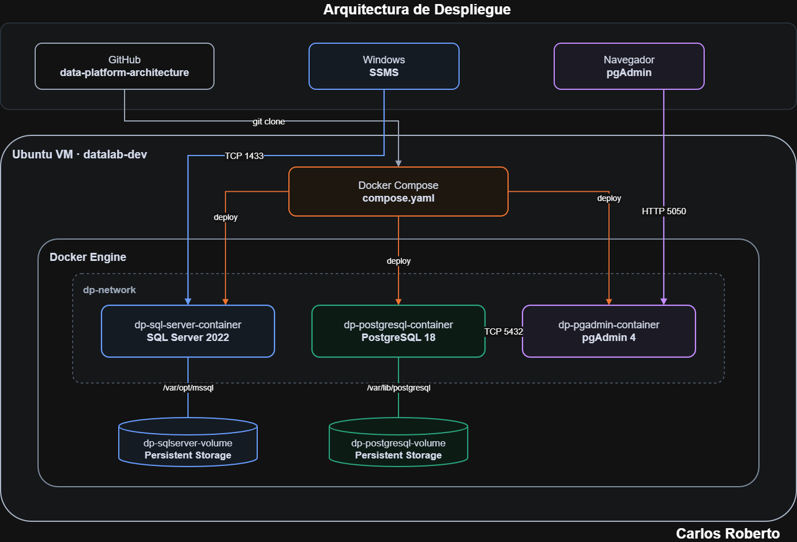

# Data Platform Architecture

Diseño, construcción y evolución progresiva de una plataforma de datos reproducible, operable y documentada.

Los datos son uno de los activos más importantes de una organización y necesitan una plataforma que permita desplegarlos, almacenarlos, protegerlos, operarlos y mantenerlos disponibles de forma simple y reproducible.

Se construye una plataforma desde una visión arquitectónica, comenzando por una infraestructura local mínima para SQL Server y evolucionando progresivamente hacia automatización, observabilidad, seguridad, resiliencia y servicios de nube.

## Arquitectura actual

La plataforma utiliza una VM Linux como base de infraestructura. Sobre ella se ejecuta Docker, se demuestra despliegue de SQL Server 2022 y PostgreSQL 18 como servicios, con almacenamiento persistente y conectividad mediante la red `dp-network`.

SQL Server se publica mediante TCP 1433 y puede administrarse desde SQL Server Management Studio. PostgreSQL se publica mediante TCP 5432 y dispone de pgAdmin como servicio web de administración mediante el puerto 5050.

**Carlos Blanco** · Administrador de Bases de Datos & Data Platform Architecture

*Data Platform Architecture*

