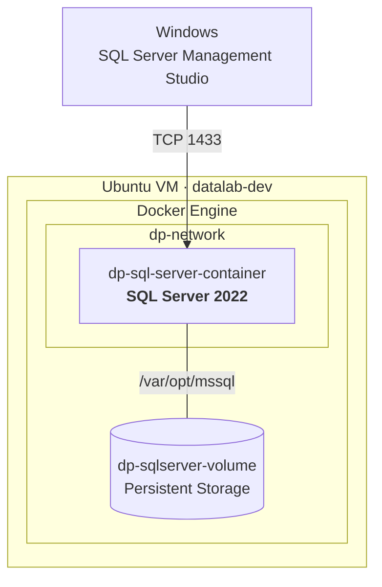

# Data Platform Architecture

Diseño, construcción y evolución progresiva de una plataforma de datos reproducible, operable y documentada.

Los datos son uno de los activos más importantes de una organización y necesitan una plataforma que permita desplegarlos, almacenarlos, protegerlos, operarlos y mantenerlos disponibles de forma simple y reproducible.

Se construye una plataforma desde una visión arquitectónica, comenzando por una infraestructura local mínima para SQL Server y evolucionando progresivamente hacia automatización, observabilidad, seguridad, resiliencia y servicios de nube.

## Arquitectura actual

La primera versión utiliza una VM Linux como base de la plataforma. Sobre ella se ejecuta Docker, donde SQL Server 2022 dispone de una red dedicada y almacenamiento persistente independiente del contenedor.

El servicio se publica mediante TCP 1433 y puede administrarse desde SQL Server Management Studio.

La arquitectura mantiene los datos independientes de la infraestructura que ejecuta SQL Server, permitiendo renovar o reconstruir la plataforma sin comprometer la información almacenada.

**Carlos Blanco** · Administrador de Bases de Datos & Data Platform Architecture

*Data Platform Architecture*

