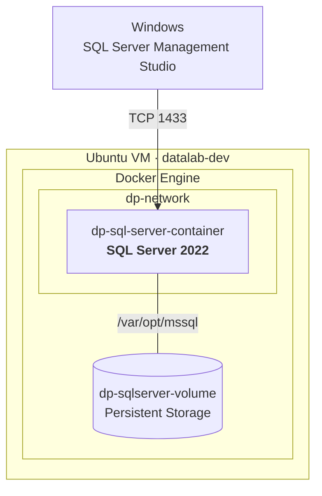

# V1: Arquitectura de plataforma local

## Componentes

| Componente | Función |
|---|---|
| `datalab-dev` | Host Linux de la plataforma |
| Docker Engine | Runtime de contenedores |
| `dp-network` | Red dedicada de la plataforma |
| `dp-sql-server-container` | Contenedor del servicio de base de datos |
| SQL Server 2022 | Motor de base de datos |
| `dp-sqlserver-volume` | Almacenamiento persistente |
| `/var/opt/mssql` | Punto de montaje de los datos |
| TCP 1433 | Acceso al servicio desde el exterior |

---

**Carlos Roberto**